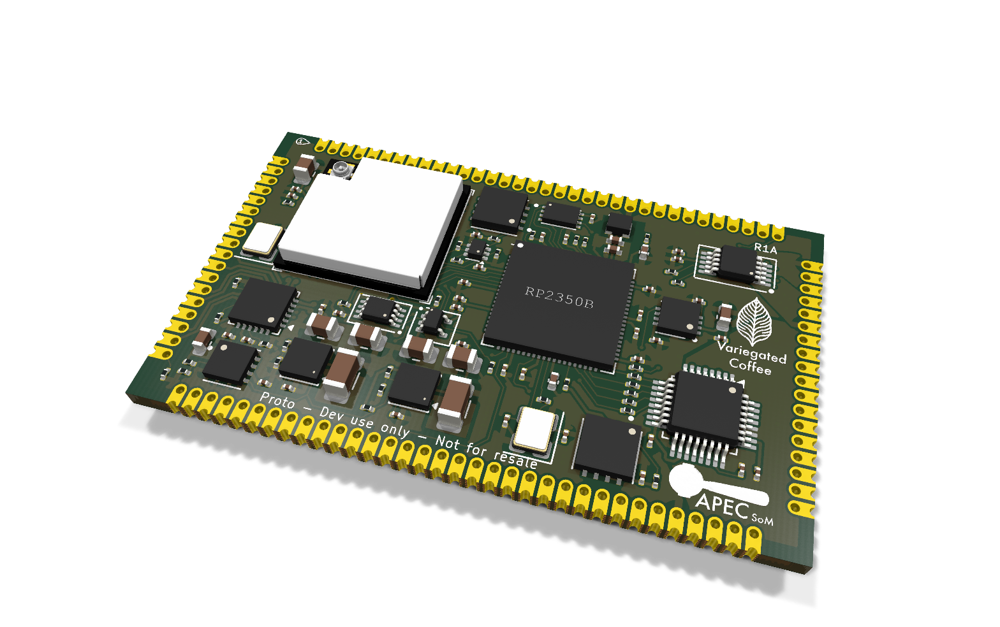

# All Purpose Espresso Controller System-on-Module

*APEC SoM R1A, rendered in KiCad.*

Espresso electronics are usually proprietary affairs with little to no expandability. The purpose of this project is to give everyone an open source alternative with lots of features and flexibility. 

The APEC SoM is a 104 pin, 1.27 mm pitch compact castellated module containing pretty much everything you need to build an espresso machine controller. The module is intended to be paired with a machine specific carrier board, containing things like connectors, FETs and passives.

## High-level features

* RP2350B microcontroller with 8 MB of program flash, 8 MB of settings flash and 8 MB PSRAM
* ESP32-C6 for Wi-fi/Bluetooth/Zigbee/Thread connectivity
* ADS124S08 ADC
* FDC1004 Capacitance-to-digital
* Five different power domains
  * Vin (6-17V)
  * 6V
  * 5VD
  * 5VA
  * 3V3
* 4-port USB 2.0 hub

## Project status

The current hardware revision is R1A. It hasn't been manufactured yet, and you shouldn't be the first one to do it. The earlier engineering validation revisions, EV1 and EV2, have been manufactured; [CHANGELOG.md](CHANGELOG.md) lists what changed between revisions.

## ⚠️ Safety warning

This project is a module intended for use as a component in a controller
for an espresso machine. Espresso machines typically use mains voltage,
high-pressure hot water and steam. Mistakes in designing, building, wiring,
or programming a controller or machine around this module can cause
electric shock, fire, burns, or scalding.

This module is not a safety component. Safety-critical protections, such
as thermal cutouts and pressure relief, must be implemented independently
of this module and its firmware. Only build or use it if you are competent
with mains electrical work and pressurised systems, and follow local
electrical regulations.

## Notice

This repository contains design files only. It is not a finished product, and it has not been tested or certified for compliance with any regulation, including but not limited to CE, UKCA or FCC requirements.

Anyone who manufactures, assembles, or places a product based on these files on the market does so as the manufacturer of that product, and is solely responsible for its safety, conformity assessment, marking, documentation, and any legal obligations that follow. If you build or use it yourself, you do so at your own risk.

The module includes a 2.4 GHz radio transceiver (ESP32-C6). Products using it are subject to radio equipment regulations in addition to other applicable requirements.

The designs are provided “as is” under the CERN-OHL-P v2. See sections 5.1 and 5.2 for the disclaimer of warranty and limitation of liability.

## License

The design files and documentation in this repository are licensed under the CERN Open Hardware Licence Version 2 – Permissive (CERN-OHL-P-2.0); see [LICENSE.txt](LICENSE.txt). This includes the carrier-board symbol and footprints (`APEC_SoM.kicad_sym` and `APEC_SoM.pretty`), so you can use them in your own carrier designs.

Some library files come from third parties and keep their own licences; see [THIRD_PARTY.md](THIRD_PARTY.md).
